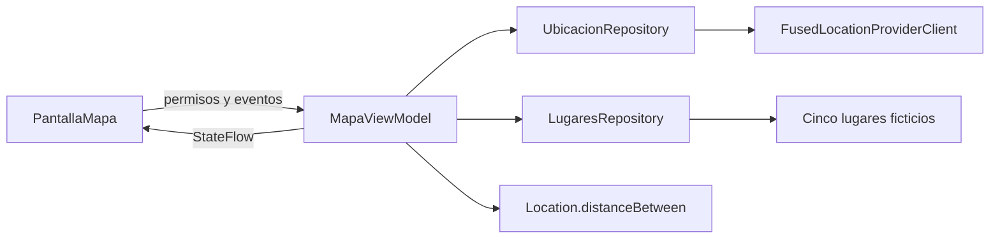

# CampusGPS · Semana 13

**Jery Becerra Ninaquispe** · Programación en Móviles

CampusGPS muestra cinco lugares ficticios de un campus en Lima. Después de obtener la ubicación del dispositivo, calcula las distancias, ordena la lista y lleva el mapa al lugar seleccionado o al más cercano. La interfaz usa una barra azul, un mapa enmarcado y tarjetas con distancias y estados de selección.

## Ejecución

1. Abre esta carpeta (`SEMANA13/Lab13`) en Android Studio con JDK 17 o posterior e instala Android SDK 37. El proyecto usa Maps Compose 8.4.0.
2. Habilita **Maps SDK for Android** en Google Cloud y restringe la clave al paquete `com.tecsup.campusgps` y al SHA-1 de tu firma. Usa `gradlew.bat signingReport` en Windows o `./gradlew signingReport` en macOS y Linux.
3. Añade `MAPS_API_KEY=TU_CLAVE` a `local.properties` junto a `sdk.dir`. Git ignora ese archivo. Sin clave, la app muestra un aviso en el panel del mapa y permite obtener la ubicación, calcular distancias y consultar la lista.
4. Usa un emulador con Google Play. En **Extended controls → Location**, fija la latitud `-12.0464` y la longitud `-77.0428`. También puedes usar `adb emu geo fix -77.0428 -12.0464` (longitud primero).
5. Pulsa **Obtener mi ubicación** y concede permiso preciso para reproducir las distancias de ejemplo. Toca una tarjeta, prueba **Ir al más cercano**, cambia el filtro y el radio.

## Arquitectura

```text
com.tecsup.campusgps
├── MainActivity.kt
├── data           UbicacionRepository, UbicacionRepositoryGoogle, LugaresRepository
├── model          Posicion, Lugar, LugarConDistancia, UbicacionUi, TipoError
├── ui             PantallaMapa, MapaUbicacion, ListaLugares, MensajeError
├── util           Distancia, Formato
└── viewmodel      MapaViewModel, CampusViewModelFactory
```



El filtro afecta a la lista y a los marcadores. **Ir al más cercano** se refiere al lugar visible más próximo. El radio de 100, 200 o 500 m dibuja un círculo alrededor de la posición y distingue en la lista los lugares dentro de él. La capa de ubicación nativa consulta el permiso al reanudar la pantalla.

## Para pensar

1. El repositorio encapsula FusedLocationProviderClient y transforma sus resultados al modelo `Posicion`. El ViewModel depende de una interfaz y puede trabajar con otra implementación.
2. El permiso de Android autoriza al usuario a compartir la posición del dispositivo con la app. La clave autoriza las solicitudes al Maps SDK. Si falta el permiso, la app muestra cómo abrir ajustes y conserva el catálogo. Si falta la clave, la app puede calcular distancias con permiso y muestra el aviso del mapa.
3. `local.properties` evita que Git publique la clave. Si se filtrara, revocaría y reemplazaría la clave en Google Cloud, revisaría su uso y coordinaría eliminarla del historial.
4. El ViewModel llama a `distanciaMetros` cuando llega la posición, ordena el resultado y lo publica. Compose solo muestra el estado y presenta unidades de lectura.
5. Tras denegaciones repetidas, Android puede dejar de mostrar el diálogo. La app mantiene disponibles los lugares y ofrece **Abrir ajustes** desde el error para que el usuario pueda conceder el permiso manualmente.

## Evidencia en emulador

Android 16, imagen Google Play. En el punto base, la lista mostró 88, 109, 173, 220 y 266 m, en ese orden. Al trasladar el emulador a las coordenadas del laboratorio, este pasó al primer lugar con 0 m. La posición y el orden se mantuvieron al rotar la pantalla. El filtro de Comida mostró solo la cafetería y la etiqueta del radio cambió entre 100 y 200 m. El permiso denegado abrió los ajustes de la aplicación. Al volver a encender la ubicación y pulsar **Reintentar**, volvió a aparecer la lista ordenada.

| Flujo | Captura |
| --- | --- |
| Inicio y cinco lugares | [01 · Inicio](evidencias/01-inicio.png) |
| Diálogo de Android | [02 · Permiso](evidencias/02-permiso.png) |
| Permiso denegado | [03 · Abrir ajustes](evidencias/03-permiso-denegado.png) |
| Coordenadas y lista ordenada | [04 · Distancias](evidencias/04-distancias.png) |
| Filtro de Comida, radio y tarjeta seleccionada | [05 · Filtro y radio](evidencias/05-filtro-y-radio.png) |
| Ubicación del dispositivo desactivada | [06 · GPS apagado](evidencias/06-gps-apagado.png) |
| Dispositivo sin Google Play Services | [07 · Sin Google Play Services](evidencias/07-sin-play-services.png) |

La validación se hizo sin clave de Google Maps. Quedan pendientes las pruebas visuales del mapa, la cámara, el círculo, los marcadores y la capa de ubicación nativa. En un segundo emulador con Android 16 AOSP, sin el paquete `com.google.android.gms`, la app mostró el aviso al solicitar ubicación y mantuvo disponibles los cinco lugares.

## Entrega asistida

El proyecto se creó en `mejora-ia` a partir de la guía. El repositorio contenía un archivo vacío para este laboratorio. Los commits separan la app base y las tres mejoras. La fase individual sin IA de la guía se realiza aparte. El registro de asistencia está en [PROMPTS.md](PROMPTS.md).
