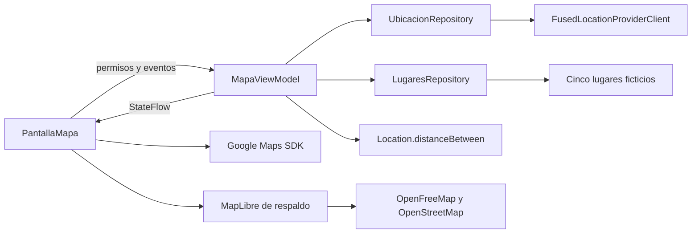

# CampusGPS · Semana 13

**Jery Becerra Ninaquispe** · Programación en Móviles

CampusGPS muestra cinco lugares ficticios de un campus en Lima. Después de obtener la ubicación del dispositivo, calcula las distancias, ordena la lista y lleva el mapa al lugar seleccionado o al más cercano. La interfaz usa un tema oscuro con acentos lima. El mapa encabeza la vista vertical, con un panel de exploración para ubicación, radio, filtros y tarjetas. En pantallas anchas, el mapa y el panel se muestran lado a lado.

## Ejecución

1. Abre `SEMANA13/Lab13` en Android Studio con JDK 17 o posterior y Android SDK 37.
2. Habilita **Maps SDK for Android** en un proyecto de Google Cloud con facturación habilitada. Crea una clave restringida al SDK, al paquete `com.tecsup.campusgps` y al SHA-1 de la firma de depuración. Obtén la huella con `gradlew.bat :app:signingReport` en Windows.
3. Guarda `MAPS_API_KEY=TU_CLAVE` en `local.properties` junto a `sdk.dir` y vuelve a ejecutar la app. El archivo está excluido de Git. Con la clave configurada, CampusGPS usa Google Maps Compose 8.4.0 en dispositivos con Google Play Services. La app usa MapLibre y OpenFreeMap como respaldo cuando falta la clave o Play Services.
4. En un emulador con Google Play Services, fija la latitud `-12.0464` y la longitud `-77.0428` en **Extended controls → Location**. También puedes usar `adb emu geo fix -77.0428 -12.0464` (longitud primero).
5. Pulsa **Obtener mi ubicación** y concede permiso preciso. Toca un punto, su nombre o una tarjeta. Usa **+** y **−** para ajustar el zoom y **Mi ubicación** para volver a centrar el mapa.

La vista inicial usa el punto de referencia ficticio del laboratorio en Lima. **Obtener mi ubicación** centra la cámara en la posición del dispositivo o en las coordenadas del emulador. Las capturas de este README se tomaron con MapLibre.

## Arquitectura

```text
com.tecsup.campusgps
├── MainActivity.kt
├── data           UbicacionRepository, UbicacionRepositoryGoogle, LugaresRepository
├── model          Posicion, Lugar, LugarConDistancia, UbicacionUi, TipoError
├── ui             PantallaMapa, MapaUbicacion, ListaLugares, MensajeError
├── util           Distancia, Formato
└── viewmodel      MapaViewModel, CampusViewModelFactory
```



El filtro afecta a la lista y a los marcadores. **Ir al más cercano** se refiere al lugar visible más próximo. El radio de 100, 200 o 500 m dibuja un círculo alrededor de la posición y distingue en la lista los lugares dentro de él. La capa de ubicación nativa consulta el permiso al reanudar la pantalla.

## Para pensar

1. El repositorio encapsula FusedLocationProviderClient y transforma sus resultados al modelo `Posicion`. El ViewModel depende de una interfaz y puede trabajar con otra implementación.
2. El permiso de Android autoriza el acceso a la ubicación del dispositivo. En el proveedor de la guía, la clave del Maps SDK autoriza las solicitudes al servicio de Google. OpenFreeMap sirve el mapa de respaldo cuando falta la clave. Si falta el permiso de ubicación, el mapa y el catálogo se pueden consultar.
3. En la variante con Google Maps, guardar la clave en `local.properties` evita publicarla con Git. Si se filtrara, revocaría y reemplazaría la clave, revisaría su uso y coordinaría eliminarla del historial. La compilación local toma la clave desde ese archivo cuando está configurada.
4. El ViewModel llama a `distanciaMetros` cuando llega la posición, ordena el resultado y lo publica. Compose solo muestra el estado y presenta unidades de lectura.
5. Tras denegaciones repetidas, Android puede dejar de mostrar el diálogo. La app mantiene disponibles los lugares y ofrece **Abrir ajustes** desde el error para que el usuario pueda conceder el permiso manualmente.

## Evidencia en emulador

Pruebas de ubicación en Android 16 con Google Play Services. En el punto base, la lista mostró 88, 109, 173, 220 y 266 m, en ese orden. Al trasladar el emulador a las coordenadas del laboratorio, este pasó al primer lugar con 0 m. La posición y el orden se mantuvieron al rotar la pantalla. El filtro de Comida mostró solo la cafetería y la etiqueta del radio cambió entre 100 y 200 m. El permiso denegado abrió los ajustes de la aplicación. Al volver a encender la ubicación y pulsar **Reintentar**, volvió a aparecer la lista ordenada.

| Flujo | Captura |
| --- | --- |
| Inicio y cinco lugares | [01 · Inicio](evidencias/01-inicio.png) |
| Diálogo de Android | [02 · Permiso](evidencias/02-permiso.png) |
| Permiso denegado | [03 · Abrir ajustes](evidencias/03-permiso-denegado.png) |
| Coordenadas y lista ordenada | [04 · Distancias](evidencias/04-distancias.png) |
| Filtro de Comida, radio y tarjeta seleccionada | [05 · Filtro y radio](evidencias/05-filtro-y-radio.png) |
| Ubicación del dispositivo desactivada | [06 · GPS apagado](evidencias/06-gps-apagado.png) |
| Dispositivo sin Google Play Services | [07 · Sin Google Play Services](evidencias/07-sin-play-services.png) |

Las capturas 01–07 corresponden a la versión anterior y documentan permisos, distancias y estados de error. Con MapLibre se comprobó que las teselas de Lima cargan sin clave, que tocar un marcador selecciona su tarjeta, que la cámara puede ir al lugar más cercano y regresar a la ubicación, y que el filtro y la selección se conservan al rotar. En Android 16 AOSP, el mapa y sus cinco marcadores siguieron disponibles al solicitar la ubicación en un dispositivo sin Google Play Services.

| Flujo con MapLibre | Captura |
| --- | --- |
| Mapa inicial y cinco marcadores | [08 · Mapa sin clave](evidencias/08-maplibre-sin-clave.png) |
| Ubicación, distancias, radio y marcador verde | [09 · Ubicación y radio](evidencias/09-ubicacion-y-radio.png) |
| Cámara en el lugar más cercano | [10 · Navegación](evidencias/10-navegacion-al-mas-cercano.png) |
| Filtro de comida aplicado al mapa y a la lista | [11 · Filtro en el mapa](evidencias/11-filtro-en-el-mapa.png) |
| Mapa y catálogo en Android AOSP | [12 · Mapa sin Play Services](evidencias/12-mapa-sin-play-services.png) |

### Interfaz actual

En Android 16 se probó el rediseño en vertical y horizontal, incluidos el cambio de categoría y de radio, la selección del lugar más cercano y el regreso de la cámara a la ubicación del usuario.

- [13 · Pantalla de exploración](evidencias/13-diseno-exploracion.png)
- [14 · Ubicación y radio](evidencias/14-diseno-ubicacion.png)
- [15 · Filtro y lugar seleccionado](evidencias/15-diseno-filtro.png)
- [16 · Vista horizontal](evidencias/16-diseno-horizontal.png)
- [17 · Lugares etiquetados y controles de zoom](evidencias/17-controles-del-mapa.png)
- [18 · Cámara centrada en otra ubicación del emulador](evidencias/18-centrado-en-ubicacion.png)

## Entrega asistida

El proyecto se creó en `mejora-ia` a partir de la guía. El repositorio contenía un archivo vacío para este laboratorio. Los commits separan la app base y las tres mejoras. La fase individual sin IA de la guía se realiza aparte. El registro de asistencia está en [PROMPTS.md](PROMPTS.md).
