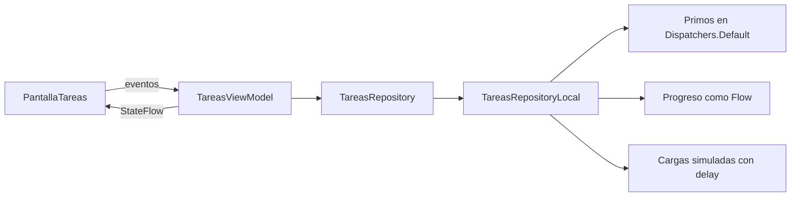

# CentroTareas · Semana 14

**Jery Becerra Ninaquispe** · Programación en Móviles

CentroTareas es un laboratorio interactivo de corrutinas. Una tarea simulada muestra progreso cancelable, un cálculo cuenta números primos y dos modos de carga permiten comparar el trabajo secuencial y paralelo. El contador **Tócame** permanece accesible al desplazar la pantalla para comprobar que la app sigue respondiendo. La interfaz usa fondo oscuro, tarjetas y controles ámbar.

## Ejecución

Abre `SEMANA14/Lab14` en Android Studio con JDK 17 o posterior y Android SDK 36. Selecciona un emulador o dispositivo y ejecuta la configuración `app`. Para generar el APK de depuración usa `gradlew.bat :app:assembleDebug` en Windows o `./gradlew :app:assembleDebug` en macOS y Linux.

1. Pulsa **Iniciar** y toca **Tócame** mientras avanza la barra. Usa **Cancelar** antes del 100 % y vuelve a iniciar. Para observar los hilos, filtra Logcat por `HILO`.
2. Cuenta primos hasta 100, 1000 y 10000. Los resultados esperados son 25, 168 y 1229. Prueba un límite grande y cancela durante el conteo.
3. Compara **Una por una** y **A la vez**. El resultado esperado son tres pedidos con tiempos aproximados de 5000 y 3000 ms. La tabla conserva las últimas cinco mediciones por modo durante la sesión.
4. Activa **Simular error**, ejecuta una carga y comprueba el recuadro rojo. Apaga el interruptor y pulsa **Reintentar**.
5. Rota el emulador durante el progreso para comprobar que el ViewModel conserva el estado.

## Arquitectura

```text
com.tecsup.centrotareas
├── MainActivity.kt
├── data           TareasRepository, TareasRepositoryLocal
├── model          PrimosUi, CargaUi
├── ui             PantallaTareas
└── viewmodel      TareasViewModel, TareasViewModelFactory
```



## Observación del Paso 1

La guía plantea bloquear el hilo principal durante cuatro segundos como demostración. En ese escenario, la cola de eventos y el renderizado quedan detenidos. El cambio a **Trabajando…** queda pendiente hasta que el hilo se libera, y el siguiente estado puede sustituirlo antes del primer fotograma renderizado. Con diez segundos de bloqueo y entrada pendiente, Android podría mostrar un diálogo de «La app no responde» (ANR). La demo bloqueante se describe aquí como resultado esperado del ejercicio.

## Para pensar

1. **Trabajando…** no se veía porque Compose necesita que el hilo principal vuelva a procesar eventos y dibuje otro fotograma.
2. `Thread.sleep` deja ocupado el hilo durante la espera. `delay` suspende una corrutina, permite que el hilo procese otros trabajos y es cancelable.
3. `Dispatchers.Default` gestiona trabajo intensivo de CPU, como probar divisores. `Dispatchers.IO` se usa para E/S bloqueante. La carga de esta app usa `delay` y puede suspenderse sin ocupar un hilo.
4. Al eliminar definitivamente el ViewModel, `viewModelScope` cancela las tareas hijas. Una rotación conserva el ViewModel y su estado.
5. Con `async`, las cargas de dos y tres segundos se solapan y la duración queda cerca de la carga más lenta. Si una falla, `coroutineScope` cancela el trabajo hermano pendiente y devuelve el error al ViewModel, que muestra el reintento.

## Evidencia en emulador

Android 16, imagen Google Play. La tarea llegó al 100 % y también se canceló al 46 %, con el contador en 1 durante la ejecución. En Logcat, las líneas de `HILO` mostraron `main → DefaultDispatcher-worker-1 → main`. Se obtuvieron 168 primos hasta 1000. Las cargas iniciales tardaron 5003 ms en secuencia y 3003 ms en paralelo. El reintento devolvió los tres pedidos tras desactivar el error.

| Flujo | Captura |
| --- | --- |
| Progreso y contador activo | [01 · Progreso](evidencias/01-progreso.png) |
| Cancelación | [02 · Cancelada](evidencias/02-cancelada.png) |
| Resultado de primos | [03 · Primos](evidencias/03-primos.png) |
| Carga secuencial y paralela | [04 · Comparación](evidencias/04-comparacion.png) |
| Error simulado | [05 · Error](evidencias/05-error.png) |

## Entrega asistida

El proyecto se creó en `mejora-ia` desde la guía. El repositorio contenía un archivo vacío para este laboratorio. Los commits separan la app base y las tres mejoras. La fase individual sin IA de la guía se realiza aparte. El registro de asistencia está en [PROMPTS.md](PROMPTS.md).
