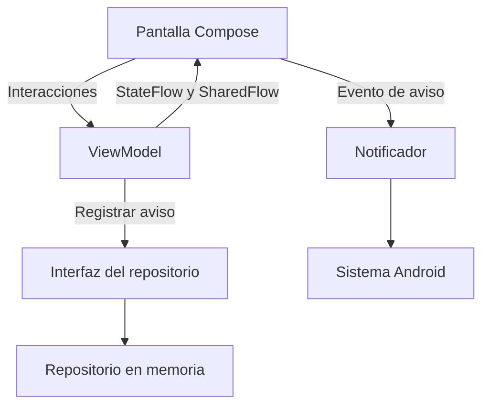
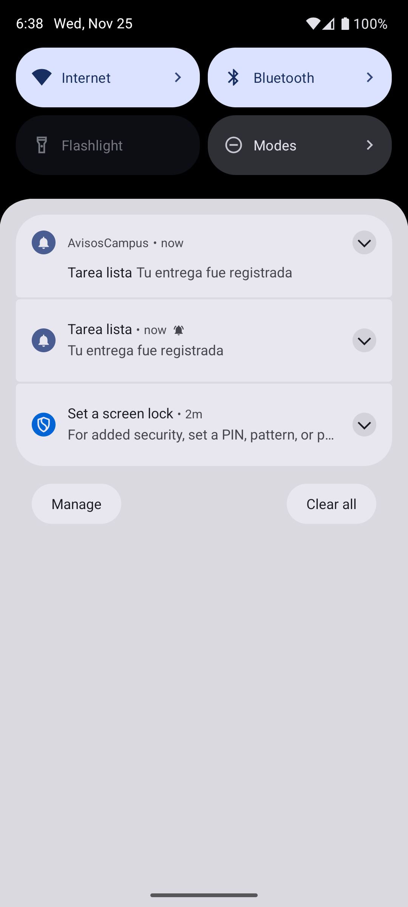
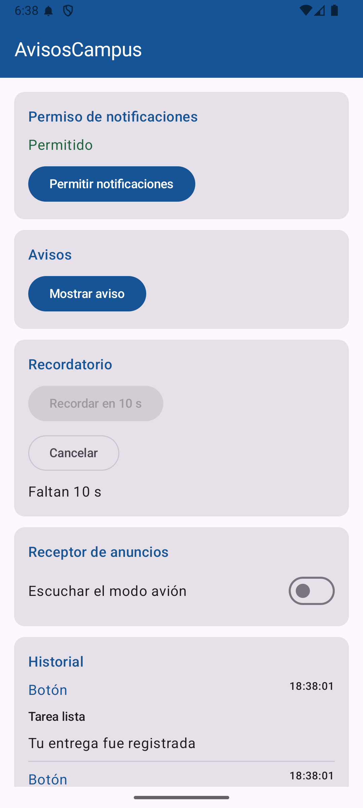
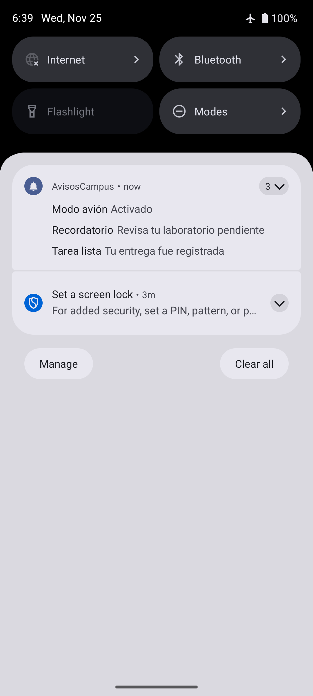
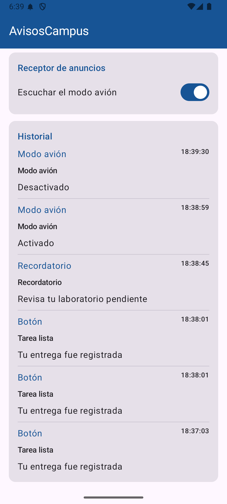
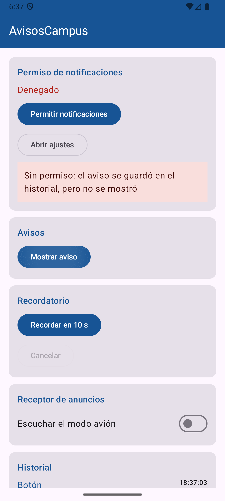

# AvisosCampus

Laboratorio 15 de Programación en Móviles. AvisosCampus genera notificaciones locales desde un botón, un recordatorio cancelable de diez segundos y los cambios del modo avión. La aplicación muestra los 20 avisos más recientes en orden cronológico inverso. Usa Kotlin, Jetpack Compose y Material 3.

## Ejecutar

1. Abre `SEMANA15/AvisosCampus` en Android Studio y sincroniza Gradle con Java 17 o superior y SDK 36.
2. Ejecuta el módulo `app` en Android 13 o superior para probar el permiso.
3. Usa Ajustes rápidos de Android para activar y desactivar el modo avión.

## Paquetes

```text
com.tecsup.avisoscampus
├── AvisosApp.kt
├── MainActivity.kt
├── data/AvisosRepository.kt
├── model/Modelos.kt
├── notificacion/Notificador.kt
├── receiver/ModoAvionReceiver.kt
├── ui/{PantallaAvisos,HistorialAvisos}.kt
└── viewmodel/{AvisosViewModel,AvisosViewModelFactory}.kt
```



## Pruebas de aceptación

| Acción | Resultado esperado |
| --- | --- |
| Consultar Ajustes de notificaciones | Existe el canal Avisos. |
| Pulsar Permitir notificaciones | Android pide el permiso y la etiqueta refleja la decisión. |
| Pulsar Mostrar aviso dos veces | Aparecen dos notificaciones Tarea lista. |
| Tocar una notificación | Se abre AvisosCampus y la notificación se quita. |
| Programar un recordatorio y minimizar | La notificación llega tras diez segundos. |
| Cancelar durante la cuenta regresiva | La cuenta termina y no se genera ningún aviso. |
| Cambiar el modo avión con la escucha activa | Se generan avisos Activado y Desactivado. |
| Cambiar el modo avión con la escucha inactiva | El historial queda igual. |
| Denegar el permiso y pulsar Mostrar aviso | Se guarda el aviso y se muestra el mensaje con acceso a Ajustes. |
| Rotar durante el recordatorio | La cuenta continúa y el historial permanece. |

## Evidencias del emulador (Android 16, API 36)

| Notificaciones | Recordatorio | Modo avión | Historial | Permiso denegado |
| --- | --- | --- | --- | --- |
|  |  |  |  |  |

Se verificó el canal Avisos, el diálogo de permiso, la recuperación desde Ajustes, dos notificaciones distintas, la apertura al tocar una notificación, la cuenta regresiva con su aviso y el historial al activar y desactivar el modo avión. Quedan por repetir las pruebas de cancelación, minimización, rotación y escucha apagada.

## Para pensar

1. **Canal y permiso.** Desde Android 8 el canal permite que el usuario configure el comportamiento del grupo. Si falta el canal en una app que tiene como destino Android 8 o superior, la notificación no se publica. Desde Android 13, si el usuario deniega el permiso, el sistema bloquea las notificaciones normales de la app.
2. **Evento del ViewModel.** El ViewModel decide y registra el aviso. La pantalla recibe el evento y delega la publicación en un componente con acceso al sistema. Así la lógica del ViewModel se puede probar sin un contexto Android.
3. **Identificador repetido.** Al publicar con el mismo identificador y etiqueta, Android actualiza la notificación que ya existe.
4. **Duración del receptor.** El receptor vuelve rápido porque ejecuta su callback en el hilo principal. Darlo de baja al salir evita conservar una pantalla o procesar anuncios después de desactivar la escucha.
5. **Local o push.** Una local sirve para un recordatorio calculado en el teléfono. Una push de Firebase sirve para avisar de un evento remoto, como un cambio de horario que publica el servidor.

## Nota sobre autoría

El proyecto base se reconstruyó a partir del contrato de la guía. La implementación recibió asistencia de ChatGPT y por ello no acredita la condición de trabajo sin IA de la Fase 1.
