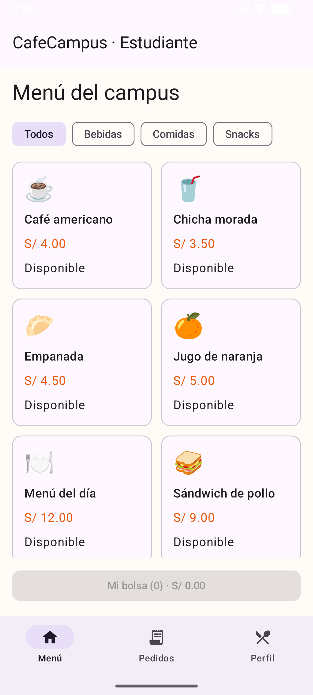
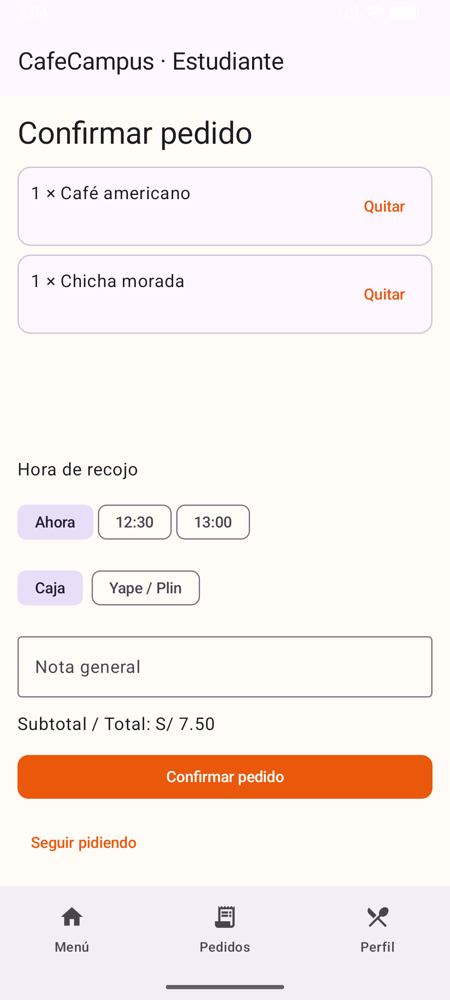
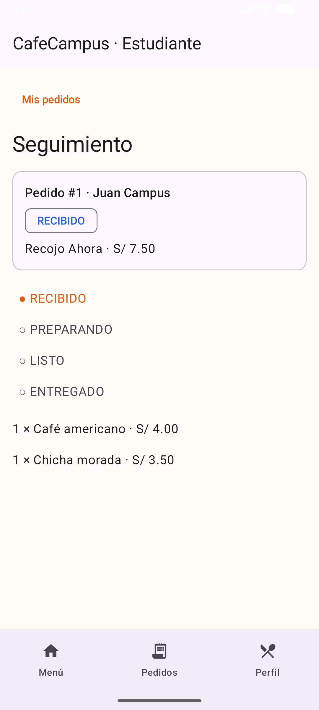
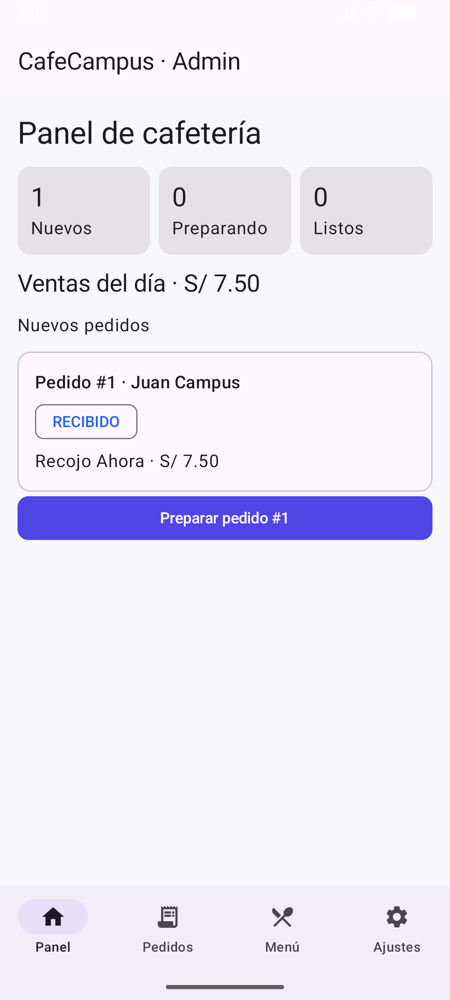
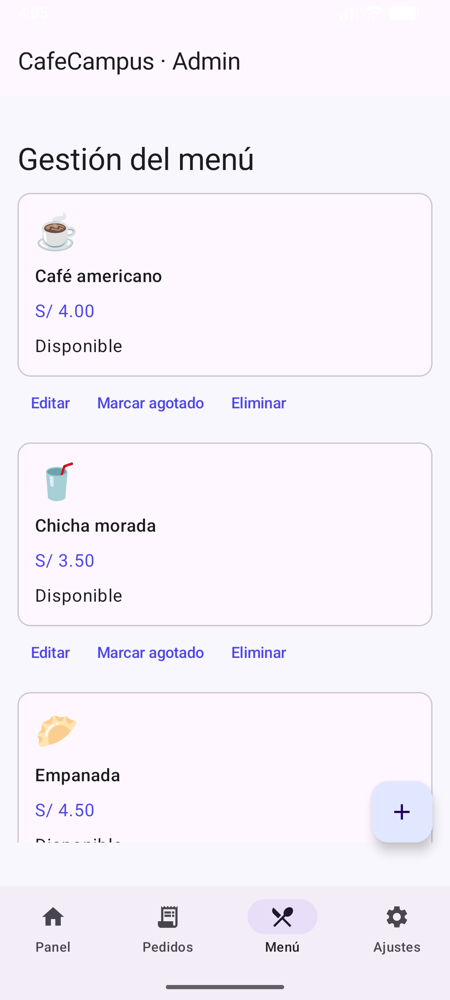
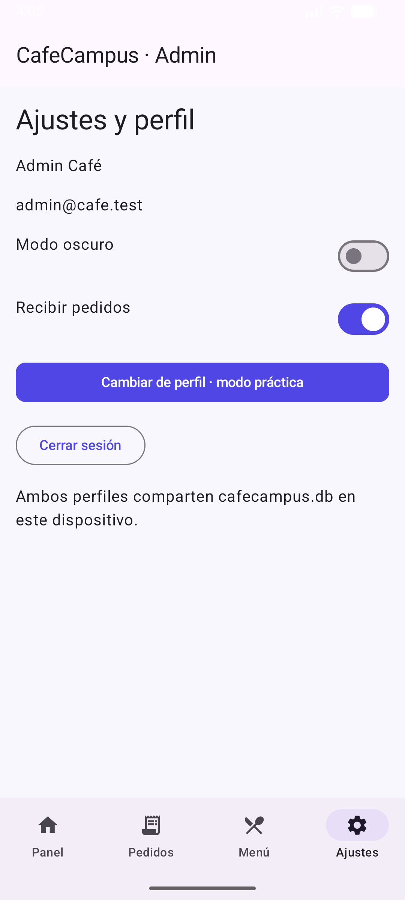
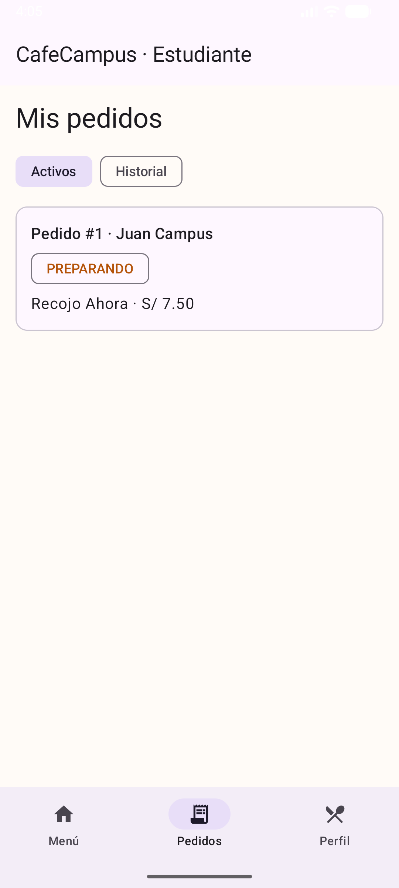

# CafeCampus — Laboratorio 8

Aplicación local de pedidos de cafetería con dos perfiles en el mismo dispositivo, Kotlin, Jetpack Compose, Material 3, MVVM, Repository interface, Room 2.6.1 y DataStore.

## Origen y autoría
Construida desde cero con asistencia de ChatGPT por solicitud explícita del estudiante. No se recibió el ZIP docente. El primer commit reconstruye la configuración; no es una importación de una base entregada.
La guía exige una fase inicial sin IA: esta implementación asistida **no cumple esa condición de autoría**. Se conserva main para el desarrollo base y mejora-ia para las mejoras, sin ocultar el origen.

## Abrir y ejecutar
Abrir esta carpeta CafeCampus en Android Studio, sincronizar Gradle, elegir un emulador API 24 o superior y ejecutar app. Usar JDK 21 instalado en la PC. Versiones: AGP 8.7.3, Gradle 8.13, Kotlin 2.0.21, KSP 2.0.21-1.0.28. UI Compose sin layouts XML.

Cuentas ficticias:
- Estudiante: juan@campus.test / 1234
- Administrador: admin@cafe.test / admin

## Arquitectura
```text
View → eventos → ViewModel → CafeRepository (interface)
View ← StateFlow ← ViewModel ← Flow ← CafeRepositoryRoom ← DAO ← Room
DataStore → preferencias → SesionViewModel → tema y ajustes
```
La View observa su ViewModel; no accede a DAOs ni Repository. Cada pedido conserva una foto del nombre y precio del producto. Escrituras suspend; lecturas reactivas Flow. Los perfiles comparten cafecampus.db.

## Paquetes
```text
com.tecsup.cafecampus
├── MainActivity / CafeApp
├── data
│   ├── local
│   │   ├── entity: Producto, Usuario, Pedido, DetallePedido
│   │   ├── dao: ProductoDao, UsuarioDao, PedidoDao
│   │   ├── relation: PedidoConDetalle
│   │   └── CafeDatabase / DatosIniciales
│   ├── repository: CafeRepository / CafeRepositoryRoom
│   └── prefs: PreferenciasStore
├── model: Rol / EstadoPedido / ItemCarrito
├── viewmodel
│   ├── CafeViewModelFactory / SesionViewModel / MenuViewModel
│   ├── PedidosClienteViewModel
│   └── PanelAdminViewModel / PedidosAdminViewModel / MenuAdminViewModel
└── ui
    ├── theme / components / navigation
    ├── cliente: Splash, Login, Menu, DetalleProducto, ConfirmarPedido, Seguimiento, MisPedidos
    └── admin: Panel, PedidosAdmin, DetallePedidoAdmin, MenuAdmin, FormularioProducto, Ajustes
```

## Procedimiento por avances
Cada bloque tuvo commit y push separado: configuración; entidades y enums; DAOs y relaciones; base singleton y siembra transaccional; Repository completo; DataStore; sesión y login; catálogo, detalle y carrito; confirmación, seguimiento e historial; panel y pedidos administrativos; edición de productos y detalle de pedidos; ajustes y navegación; pruebas; documentación y capturas.
Los pasos están explicados en ../INDICACIONES-FASE-MANUAL.md. Ese archivo corresponde a la petición anterior de trabajo personal; ahora la implementación está asistida y lo declara ORIGEN-Y-ASISTENCIA.md.

## Funciones
- Inicio de sesión con validación de credenciales y rol.
- Catálogo con categorías y disponibilidad.
- Carrito sin duplicar productos y con total calculado.
- Confirmación transaccional con hora, pago y notas.
- Seguimiento e historial reactivos por estudiante.
- Panel de contadores y ventas sin cancelados.
- Administración de estados y productos; confirmación antes de eliminar.
- Validación del formulario y precio positivo finito.
- Cambio de perfil en modo práctica y cierre de sesión.
- Modo oscuro y recepción de pedidos guardados con DataStore.

## Capturas reales
Tres vistas de estudiante:




Tres vistas de administrador:




Cambio compartido por Flow:


## Para pensar — respuestas propuestas para revisar con palabras propias
El Repository es una interface para intercambiar la fuente de datos sin cambiar los ViewModels.
crearPedido es suspend porque realiza una escritura única; observarPedidosCliente es Flow porque emite cambios.
Con bases distintas el administrador y el estudiante no verían el mismo pedido actualizado.
Para usar servidor cambiaría la implementación del Repository y la sincronización, manteniendo el contrato.

## Observaciones
1. Room necesitó índices en las claves foráneas y una transacción para que cabecera y líneas se guardaran juntas.
2. El emulador actual requirió Espresso actualizado; además, la recreación de Activity conserva la ruta y el carrito mientras el proceso vive.

## Conclusiones
1. Compartir Room y observar Flow permite reflejar cambios administrativos sin recargar manualmente las pantallas.
2. Guardar precio y nombre en el detalle conserva el historial aunque cambie o desaparezca el producto.

## Verificación
Compilación de app y APK de pruebas confirmada. Pruebas de Room: credenciales, siembra idempotente, dos productos, total, estados, cancelación, ventas, precio histórico, eliminación y rechazo de agotados verificadas.
Recorrido UI y capturas ejecutados; el resultado final se registra en VERIFICACION.md.
La persistencia del carrito está garantizada por ViewModel en rotación; el carrito no es persistente tras muerte del proceso (los pedidos confirmados sí están en Room).

## Uso de Git
```text
git log --oneline -- SEMANA8/CafeCampus
git push origin main
git push origin mejora-ia
```
No se fabricaron commits vacíos. PROMPTS.md registra solicitudes y correcciones reales; no declara participación de Gemini.


## Guía completada y revisión del 23 de octubre

La guía original completada con evidencias, código en capturas, pruebas de aceptación marcadas y cinco conclusiones está en ../GLAB-S08-JLEONS-2026-1.pdf.
Se ampliaron las pruebas de preferencias, recepción cerrada y persistencia tras cerrar el proceso. Véase VERIFICACION.md para el orden y las precondiciones de la prueba de reinicio.
